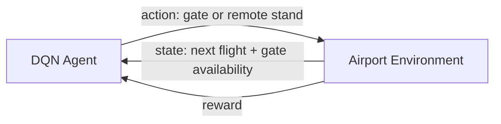
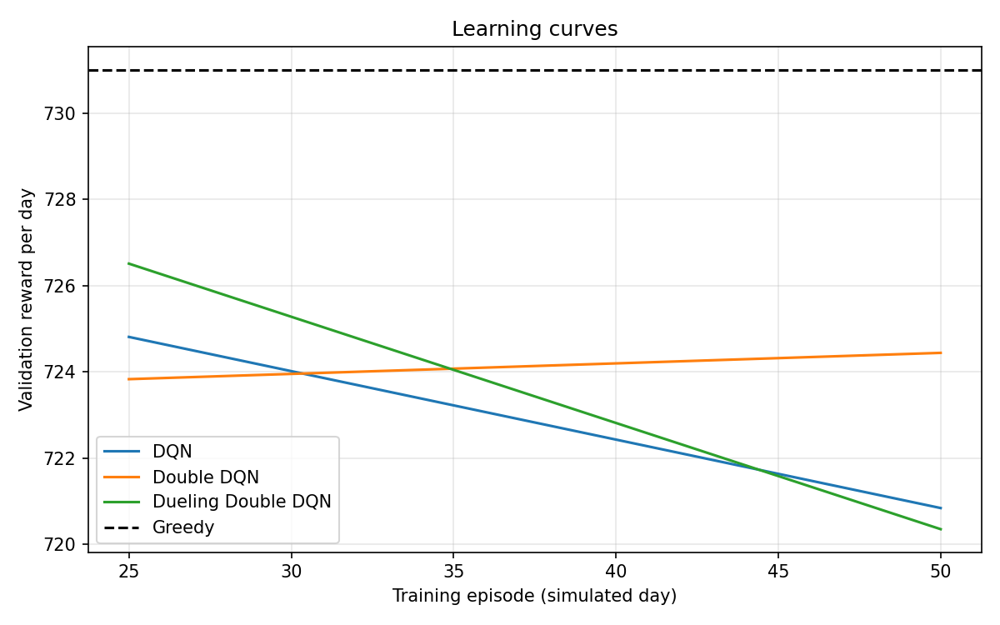
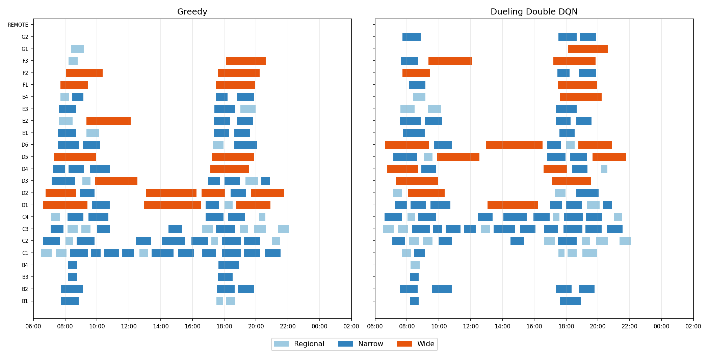

# $\color{Red}{\textsf{GateMind: Deep Reinforcement Learning for Airport Gate Assignment}}$

<div align="center">


</div>


### Table of Contents

1. [Overview](#color1f6febtextsfoverview)
2. [The Problem](#color1f6febtextsfthe-problem)
3. [The Environment](#color1f6febtextsfthe-environment)
4. [MDP Formulation](#color1f6febtextsfmdp-formulation)
5. [Reward Function](#color1f6febtextsfreward-function)
6. [The Agents](#color1f6febtextsfthe-agents)
7. [Evaluation](#color1f6febtextsfevaluation)
8. [Results](#color1f6febtextsfresults)
9. [Roadmap](#color1f6febtextsfroadmap)
10. [References](#color1f6febtextsfreferences)

<br>


## $\color{#1F6FEB}{\textsf{The Motivation}}$

The **Airport Gate Assignment Problem (AGAP)** consists of **assigning each flight to a gate** while respecting operational constraints and **maximizing both passenger convenience** and **airport efficiency**. The problem has been studied since the 1970s, with traditional approaches mainly relying on **mathematical optimization**.


<div align="center">


</div>


### $\color{#E36209}{\textsf{Why Reinforcement Learning?}}$

A natural approach is a **greedy rule**: give each arriving flight the closest free gate that fits. This rule is short-sighted:

- A narrow-body aircraft is parked at a wide-body gate because it is the closest one available.
- Two hours later, a wide-body aircraft arrives and no compatible gate is free, so it goes to a remote stand.

A good assignment depends on **the flights that have not arrived yet**. This is a sequential decision problem, where today's choice changes tomorrow's options, which is exactly what RL is designed for.

<br>

## $\color{#1F6FEB}{\textsf{GateMind : Overview}}$

**GateMind** is a `Deep Reinforcement Learning` project that develops an agent able to **assign airport gates to arriving flights automatically**, using a simulated airport and synthetic flight schedules.

- Each time a flight arrives, the agent chooses a gate for it, or sends it to a remote stand when no suitable gate is available.
- Every assignment must respect the operational constraints: **aircraft size and gate compatibility**, **gate availability**, and **operational restrictions** of each pier.
- Among the valid choices, the agent learns to pick the most **efficient** one: avoiding delays and remote stands, limiting walking distance, and not wasting large gates on small aircraft.
- The project evaluates a **Deep Q-Network (DQN)** and two of its variants, against **random** and **greedy rule-based** agents used as reference points.

### $\color{#E36209}{\textsf{Research question}}$

> Can a DQN agent learn to assign gates to flights in a way that respects all operational constraints while making efficient use of the airport's resources?


<br>


## $\color{#1F6FEB}{\textsf{The Environment}}$

The environment is a **simplified airport inspired by [Amsterdam Schiphol Airport (AMS)](https://www.oneworld.com/airport-maps/ams)**. It keeps Schiphol's structure (several piers with different roles, contact gates and remote stands, size limits per pier) but uses a reduced number of gates and synthetic distances. It is not an exact model of the real airport.

<div align="center">


</div>

### $\color{#E36209}{\textsf{Gates}}$

<div align="center">

| Gate | Max aircraft size | Role | Distance to terminal | Gates in simulation |
| ---  | --- | --- | --- | ---: |
| B    | Narrow-body | Regional and short-haul flights, fast turnaround | Long | 4 |
| C    | Narrow-body | Short-haul flights | Medium | 4 |
| D    | Wide-body | Most flexible group, all aircraft types | Short | 6 |
| E    | Wide-body | Long-haul flights | Medium | 4 |
| F    | Wide-body | Long-haul international flights | Medium | 3 |
| G    | Wide-body | Long-haul flights, limited availability | Long | 2 |
| Remote stands | Any | Used when no gate is suitable, bus transfer needed | Longest | 1 |


</div>


### $\color{#E36209}{\textsf{Aircraft Categories}}$

<div align="center">

| Category | Example aircraft | Turnaround |
| --- | --- | --- |
| Regional | Embraer E190 | Short |
| Narrow-body | Airbus A320, Boeing 737 | Medium |
| Wide-body | Boeing 777, Airbus A350 | Long |

</div>

### $\color{#E36209}{\textsf{Flight Schedule Generator}}$

$\color{Red}{\textsf{No real schedule data was used}}$. Each episode is a **simulated day of flights** produced by a schedule generator:

- Arrival times follow daily patterns, with **morning and evening peaks**.
- Each flight gets an aircraft category, drawn from a realistic fleet mix.
- The turnaround time depends on the category, with some random variation.
- Each day is generated from a random seed, so the agent sees a different day every episode and must **generalize** instead of memorizing one schedule.

<br>


## $\color{#1F6FEB}{\textsf{MDP Formulation}}$

The problem is modeled as a **Markov Decision Process (MDP)**. Each decision step corresponds to **one arriving flight**: flights are processed in order of arrival, and the agent assigns them one by one.

$$\mathcal{M} = (\mathcal{S}, \mathcal{A}, P, R, \mathcal{T}, \gamma)$$

<br>



<br>

<div align="center">

| Symbol | Element | Definition |
| --- | --- | --- |
| $\mathcal{S}$ | State space | Features of the incoming flight + for each gate: time until it becomes free and whether it fits the aircraft |
| $\mathcal{A}$ | Action space | $\lbrace \text{gate}_1, \dots, \text{gate}_N, \text{remote} \rbrace$: $N + 1$ discrete actions |
| $P(s' \mid s, a)$ | Transition function | Deterministic. The chosen gate becomes occupied until the flight departs, then the next flight arrives |
| $R(s, a, s')$ | Reward function | Defined in the next section |
| $\mathcal{T}$ | Terminal state | All flights of the day have been assigned |
| $\gamma$ | Discount factor | $\gamma = 0.99$ |

</div>

### $\color{#E36209}{\textsf{State}}$

The state is a vector given to the neural network:

- **Incoming flight:** aircraft category, arrival time in the day, expected turnaround time.
- **For each gate:** time remaining until the gate is free (0 if free), and a compatibility flag (1 if the aircraft fits the gate).

Using the *time until free* instead of a simple free/occupied flag keeps the state **Markov**: the agent knows everything needed to predict which gates will be available for the next flights.

### $\color{#E36209}{\textsf{Action Masking}}$

Some actions are always invalid: a gate that is occupied, or too small for the aircraft. Instead of letting the agent try them and punishing it, these actions are **masked**: their Q-values are set to $-\infty$, so the agent can never select them.

$$\mathcal{A}_{\text{valid}}(s) = \lbrace g : g \text{ is free at arrival and } \text{size}(f) \le \text{size}(g) \rbrace \cup \lbrace \text{remote} \rbrace$$

The remote stand is always valid, so the agent always has at least one possible action. As a result, **gate conflicts and size violations are impossible by design**, and the agent only learns *which valid gate is the best choice*.

<br>

## $\color{#1F6FEB}{\textsf{Reward Function}}$

The reward follows the two main goals of gate assignment: **passenger convenience** (board at the terminal, walk less) and **efficient use of gates** (keep large gates for large aircraft). Each goal becomes one term of the reward. Hard constraints are not in the reward, since the action mask already blocks them.

<div align="center">

| Event | Effect | Purpose |
| --- | --- | --- |
| Flight assigned to a contact gate | Positive | Keep flights at the terminal |
| Walking distance of the gate | Negative | Prefer gates close to the terminal |
| Small aircraft at a large gate | Negative | Keep large gates for large aircraft |
| Flight sent to a remote stand | Negative | Avoid bus transfers |

</div>

For a flight $f$ assigned to gate $g$:

$$
R =
\begin{cases}
r_{\text{contact}} - d(g) - m(f, g) & \text{if } g \text{ is a contact gate} \\
-r_{\text{remote}} & \text{if } g \text{ is a remote stand}
\end{cases}
$$

where:

- $r_{\text{contact}}$ is the reward for using a contact gate,
- $d(g)$ is the walking distance penalty of gate $g$,
- $m(f, g)$ is the size mismatch penalty (0 if the aircraft matches the gate size),
- $r_{\text{remote}}$ is the remote stand penalty.

The values are set in the configuration file so that a contact gate is always better than a remote stand.

<br>

<br>


## $\color{#1F6FEB}{\textsf{The Agents}}$

The project evaluates five agents. Each one adds a single change compared to the previous one, so the effect of every change can be measured.

<div align="center">

| # | Agent | Type | Looks ahead? |
| --- | --- | --- | --- |
| 1 | Random | Picks a random valid gate | No |
| 2 | Greedy | Picks the closest valid gate that fits | No |
| 3 | DQN | Neural Q-network, replay buffer, target network | Yes |
| 4 | Double DQN | DQN with decoupled action selection and evaluation | Yes |
| 5 | Dueling Double DQN | Double DQN with a value / advantage network | Yes |

</div>

All agents use the same action mask, so they all produce valid schedules. The difference is the **quality** of the schedule.

### $\color{#E36209}{\textsf{What Each Comparison Answers}}$

<div align="center">

| Comparison | Question |
| --- | --- |
| 1 vs 2 | How much does a simple rule improve over random choices? |
| 2 vs 3 | Does learning to look ahead beat the greedy rule? |
| 3 vs 4 | Does reducing overestimation improve the policy? |
| 4 vs 5 | Does the dueling architecture help when many gates are similar? |

</div>


<br>


## $\color{#1F6FEB}{\textsf{Evaluation}}$

Each agent is trained with 5 random seeds, then tested on the **same set of new simulated days**.

<div align="center">

| Metric | What it measures |
| --- | --- |
| Contact gate rate | Share of flights assigned to a contact gate (the rest go to remote stands) |
| Walking distance | Average walking distance per flight |
| Size mismatch | How often small aircraft use large gates |
| Total reward | Overall quality of the day's schedule |
| Gap to optimal | Difference with the best possible schedule |

</div>

We also plot the **learning curves** (reward over training) and a **Gantt chart** of the final schedule, showing which flight uses each gate over the day.

<div align="center">


</div>

<br>


## $\color{#1F6FEB}{\textsf{Project Structure}}$

```bash
gatemind/
│
├── configs/
│   ├── airport.yaml           # Gates: group, max size, distance, count + remote stands
│   └── default.yaml           # Reward values, DQN hyperparameters, seeds, episodes
│
│   # Main package
├── gatemind/
│   ├── data/
│   │   └── schedule_generator.py  # Generates one simulated day of flights
│   ├── env/
│   │   ├── airport.py             # Loads gates from airport.yaml, tracks when each gate is free
│   │   └── gate_env.py            # Custom Gymnasium env: state, action mask, reward, transitions
│   ├── agents/
│   │   ├── random_agent.py        # Random valid gate
│   │   ├── greedy_agent.py        # Closest valid gate
│   │   ├── networks.py            # Q-network and dueling Q-network (PyTorch)
│   │   ├── replay_buffer.py       # Stores and samples transitions
│   │   └── dqn_agent.py           # DQN, with options for Double and Dueling
│   ├── planning/
│   │   └── optimal.py             # Offline best schedule (solver), optional
│   └── utils/
│       ├── metrics.py             # Contact gate rate, walking distance, size mismatch...
│       └── plotting.py            # Learning curves, Gantt charts
│
├── scripts/
│   ├── train.py               # Trains the DQN agents over 5 seeds
│   ├── evaluate.py            # Runs all agents on the test days, builds the metrics table
│   └── plot_results.py        # Generates the figures
│
├── results/                   # Saved models, logs, figures
│
├── tests/
│   ├── test_generator.py      # Flights are valid (times, categories)
│   ├── test_env.py            # Masking, rewards, gate occupancy, episode end
│   └── test_agents.py         # Agents only pick valid actions
│
├── main.py                    # Entry point: python main.py train / evaluate / plot
├── requirements.txt
└── README.md
```

<br>

## $\color{#1F6FEB}{\textsf{Results}}$

Each learning agent was trained for 500 episodes (simulated days) with 5 different random seeds. All agents were then tested on the same **20 unseen days**.

```bash
python main.py train
python main.py evaluate
python main.py plot
```

- The table shows the average over the 20 test days, with the standard deviation across seeds in parentheses.

<div align="center">

| Agent | Contact gate rate | Remote stands per day | Walking time (min) | Size mismatch | Reward |
|---|---:|---:|---:|---:|---:|
| Random | 89.0% (0.6) | 10.96 (0.63) | 7.30 (0.05) | 50.0% (0.6) | 547.6 (11.1) |
| **Greedy** | **99.0%** | **1.00** | **5.71** | **45.4%** | **758.2** |
| DQN | 98.7% (0.3) | 1.26 (0.25) | 5.96 (0.17) | 54.2% (3.7) | 734.3 (5.1) |
| Double DQN | 98.9% (0.1) | 1.09 (0.14) | 6.12 (0.37) | 52.0% (3.4) | 734.1 (5.4) |
| Dueling Double DQN | 98.9% (0.1) | 1.08 (0.07) | 6.07 (0.33) | 51.5% (1.9) | 737.8 (7.2) |

</div>

**How to read the table:**

- **Size mismatch** is the share of flights parked at a gate larger than needed (for example, a narrow-body at a wide-body gate).
- **Greedy** is deterministic, so it has no standard deviation.
- Higher is better for contact gate rate and reward. Lower is better for remote stands, walking time and size mismatch.

### $\color{#E36209}{\textsf{1. The DQN Agents Do Not Beat Greedy}}$

- All three DQN agents clearly outperform the random agent (about **+190 reward per day**) and keep almost every flight at a contact gate (**~99%**).
- However, **none of them beats the greedy agent**, on any metric. They score about **20 to 24 points per day below greedy**.
- The largest gap is in **size mismatch**: the DQN agents park **51 to 54%** of flights at gates larger than needed, against **45%** for greedy. This is the opposite of what we expected, since keeping large gates free for wide-body aircraft was the main way a planning agent could improve on greedy.
- Between the three variants, the differences are small and within the standard deviation. Dueling Double DQN is slightly ahead, but not significantly.

### $\color{#E36209}{\textsf{2. Training Made the Agents Worse}}$

<div align="center">
  
</div>

The learning curves show the validation reward during training (mean across seeds, with the standard deviation as a shaded band). The dashed line is the greedy agent.

- At the first evaluation (episode 25), all agents already score around **727**, close to greedy (731).
- During training, the reward then **decreases** to around **705–710** and stays there.

This means the agents did not learn a better policy. They started from a reasonable one and drifted away from it. The reason is explained in the [Issues and Possible Fixes](#color1f6febtextsfissues-and-possible-fixes) section.

### $\color{#E36209}{\textsf{3. Comparing the Schedules}}$

<div align="center">
  
</div>

The Gantt charts show the schedules of the greedy agent and the Dueling Double DQN agent (seed 0) on the same test day. Each bar is one flight, from arrival to departure, colored by aircraft category.

- **Greedy** fills the closest gates first. In the morning, several D gates (wide-body gates close to the terminal) are used by narrow-body aircraft.
- **Dueling Double DQN** uses the C gates more for narrow-body aircraft, which is a good choice. But it still parks narrow-body aircraft at wide-body gates (D, E, F, G), sometimes far from the terminal (F1, G2), which increases both walking time and size mismatch.
- Neither agent sends a flight to a remote stand on this day.

<br>

## $\color{#1F6FEB}{\textsf{Issues and Possible Fixes}}$

### $\color{#E36209}{\textsf{Why the DQN Agents Struggle}}$

**1. The useful signal is hidden in the reward.** Every flight assigned to a contact gate receives about **+10**, while the difference between a good gate and a bad one is only **1 to 4 points**. Most of the reward says "the flight got a gate", which is true for almost every choice.

**2. The Q-values are large compared to these differences.** With γ = 0.99 and 100 flights per day, the Q-values reach several hundred. A prediction error of only 1% is already larger than the difference between two gates, so the network cannot reliably tell which gate is better.

**3. Greedy is already close to the best possible schedule.** With 100 flights per day, the airport is rarely full: greedy sends only one flight per day to a remote stand. This leaves little room for a planning agent to improve.

The early validation score (727) confirms this. An almost untrained network rarely chooses the remote stand, and any contact gate already gives +5 to +9, so even a nearly random choice among contact gates scores well. Training then adds noise instead of useful information.

### $\color{#E36209}{\textsf{Possible Fixes}}$

<div align="center">

| Fix | Change | Expected effect |
| --- | --- | --- |
| Shift the reward | Contact gate reward from +10 to 0 (penalties unchanged) | Removes the large constant part of the reward, so the differences between gates become the main signal. Since every day has the same number of flights, the best schedule does not change. |
| Lower the discount factor | γ from 0.99 to 0.95 | The agent looks about 20 flights ahead instead of the whole day: enough to plan for the next peak, with smaller and less noisy Q-values. |
| Increase congestion | 110 to 120 flights per day | Gates become scarce more often, so planning ahead matters more and greedy has more room to make mistakes. |

</div>

These changes will be tested in a next version of the project.

<br>


## $\color{#1F6FEB}{\textsf{Roadmap}}$

- [x] Airport configuration and flight schedule generator
- [x] Gymnasium environment with action masking, tested with the random agent
- [x] Greedy baseline
- [x] DQN agent
- [x] Double DQN and Dueling DQN
- [x] Offline optimal reference
- [x] Evaluation, learning curves and Gantt charts
- [ ] Optional: random flight delays (stochastic environment)

<br>


## $\color{#1F6FEB}{\textsf{References}}$

1. Sutton, R. S., and Barto, A. G. (2018). [*Reinforcement Learning: An Introduction* (2nd ed.)](http://incompleteideas.net/book/the-book-2nd.html). MIT Press.
2. Bouras, A., Ghaleb, M. A., Suryahatmaja, U. S., and Salem, A. M. (2014). [The Airport Gate Assignment Problem: A Survey](https://doi.org/10.1155/2014/923859). *The Scientific World Journal*.
3. Daş, G. S., Gzara, F., and Stützle, T. (2020). [A review on airport gate assignment problems: Single versus multi objective approaches](https://ideas.repec.org/a/eee/jomega/v92y2020ics0305048319306000.html). *Omega*, 92.
4. Li, H., Wu, X., Ribeiro, M., Santos, B., and Zheng, P. (2025). [Deep reinforcement learning approach for real-time airport gate assignment](https://doi.org/10.1016/j.orp.2025.100338). *Operations Research Perspectives*, 14.
5. Mnih, V., et al. (2015). [Human-level control through deep reinforcement learning](https://www.nature.com/articles/nature14236). *Nature*, 518, 529–533.
6. van Hasselt, H., Guez, A., and Silver, D. (2016). [Deep Reinforcement Learning with Double Q-learning](https://arxiv.org/abs/1509.06461). *AAAI Conference on Artificial Intelligence*.
7. Wang, Z., Schaul, T., Hessel, M., van Hasselt, H., Lanctot, M., and de Freitas, N. (2016). [Dueling Network Architectures for Deep Reinforcement Learning](https://arxiv.org/abs/1511.06581). *ICML*.